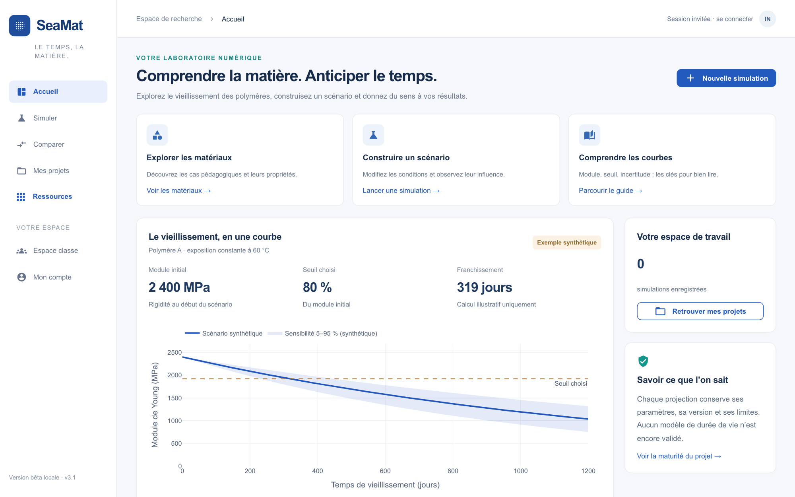

# SeaMat

**Prédire, comparer et documenter le vieillissement des polymères.**

SeaMat est une application Python destinée aux étudiants, enseignants et chercheurs en matériaux. Elle permet de sélectionner ou décrire un polymère, définir ses conditions de service, générer une courbe de vieillissement du module de Young, comparer plusieurs scénarios et exporter un résultat traçable.

> **Version 3.1.1 — Windows, macOS, Linux et Docker**
>
> Interface en français · Python 3.11 à 3.13 · NiceGUI · Plotly · SQLite



## Documents à télécharger

| Document | PDF prêt à lire | Version Word modifiable |
|---|---|---|
| **Guide complet d’utilisation** — prise en main, écrans annotés, interprétation des résultats, exports et problèmes courants | [Ouvrir le guide PDF](livrables/01_Guide_utilisation/SeaMat_Guide_utilisation_complet.pdf) | [Télécharger le guide Word](livrables/01_Guide_utilisation/SeaMat_Guide_utilisation_complet.docx) |
| **Rapport scientifique** — contexte, méthode, équations, architecture, validation, limites et perspectives | [Ouvrir le rapport PDF](livrables/02_Rapport_scientifique/SeaMat_Rapport_scientifique.pdf) | [Télécharger le rapport Word](livrables/02_Rapport_scientifique/SeaMat_Rapport_scientifique.docx) |

Le [sommaire de la documentation](README.md) donne accès aux documents techniques, aux audits et aux études de validation.

## Lancer SeaMat

### Applications prêtes à utiliser — sans installer Python

| Système | Téléchargement direct |
|---|---|
| **Windows 10/11, 64 bits** | [Télécharger SeaMat-Windows-x64.exe](https://github.com/chillneonpro-bot/SeaMat/releases/latest/download/SeaMat-Windows-x64.exe) |
| **macOS Apple Silicon** — M1, M2, M3, M4… | [Télécharger SeaMat-macOS-Apple-Silicon.zip](https://github.com/chillneonpro-bot/SeaMat/releases/latest/download/SeaMat-macOS-Apple-Silicon.zip) |
| **macOS Intel** | [Télécharger SeaMat-macOS-Intel.zip](https://github.com/chillneonpro-bot/SeaMat/releases/latest/download/SeaMat-macOS-Intel.zip) |

Ces versions autonomes ouvrent SeaMat dans une fenêtre d’application et conservent les données dans le profil de l’utilisateur. Consultez la [dernière version publiée](https://github.com/chillneonpro-bot/SeaMat/releases/latest) pour les instructions du premier lancement et les empreintes SHA-256.

### Installation depuis le code source

#### Windows

1. Télécharger le dépôt avec **Code → Download ZIP**.
2. Extraire complètement le fichier ZIP.
3. Installer [Python 3.11, 3.12 ou 3.13](https://www.python.org/downloads/) si nécessaire.
4. Double-cliquer sur **`Lancer-SeaMat-Windows.bat`**.

#### macOS

1. Télécharger puis décompresser le dépôt.
2. Installer [Python 3.11, 3.12 ou 3.13](https://www.python.org/downloads/) si nécessaire.
3. Double-cliquer sur **`Lancer-SeaMat.command`**.
4. Si macOS bloque le premier lancement, faire un clic droit sur le fichier, choisir **Ouvrir**, puis confirmer.

Au premier démarrage, le lanceur crée un environnement isolé et installe automatiquement les dépendances. SeaMat s’ouvre ensuite sur [http://127.0.0.1:8088](http://127.0.0.1:8088).

#### Docker

```sh
docker compose up --build
```

Les instructions détaillées, le déploiement pour une classe et les variables de serveur sont décrits dans le [guide d’installation](INSTALLATION.md).

## Parcours conseillé

1. Ouvrir **Matériaux** et sélectionner une fiche ou créer un matériau personnalisé.
2. Ouvrir **Simuler**, puis choisir une estimation depuis une fiche ou depuis des mesures publiées.
3. Renseigner le grade, le module initial, les conditions de service, l’horizon et le seuil conservé.
4. Lire le niveau de preuve et la précision affichée avant d’interpréter la courbe.
5. Comparer plusieurs matériaux avec les mêmes conditions.
6. Exporter le classeur Excel ou le rapport et conserver les paramètres avec le résultat.

Le [guide complet](livrables/01_Guide_utilisation/SeaMat_Guide_utilisation_complet.pdf) explique chaque champ, chaque phrase de l’interface et la manière d’exploiter les résultats.

## Fonctions principales

- Catalogue structuré de **75 matériaux** et profils documentés de module initial.
- Ajout manuel d’un polymère avec recherche d’analogues et contrôle d’applicabilité.
- Courbes du module de Young selon le temps, la température, l’humidité, l’épaisseur et le milieu.
- Paramètres avancés pour les mécanismes thermiques, hydriques, UV et la rigidification.
- Comparaison de un à quatre matériaux ou simulations enregistrées.
- Import de séries expérimentales et de mesures publiées.
- Validation aveugle entre prédictions figées et résultats de laboratoire.
- Indicateurs d’erreur, de couverture, de domaine et de niveau de preuve.
- Exports Excel, PDF, JSON et rapports étudiants.
- Comptes locaux, projets, espace classe et remise de travaux.
- Bibliothèque de documents et traçabilité des sources.

## Lire correctement un résultat

La **courbe centrale** est l’estimation produite pour les paramètres saisis. La **bande** représente la sensibilité ou l’intervalle prédictif associé au niveau de preuve disponible. Le **temps au seuil** indique quand le module central atteint le pourcentage conservé choisi.

Un résultat n’a pas la même portée selon son origine :

| Niveau affiché | Interprétation |
|---|---|
| Mesures compatibles du grade | Résultat le plus directement exploitable dans la fenêtre observée |
| Modèle validé sur groupes masqués | Prédiction accompagnée de métriques de validation |
| Transfert par analogue | Estimation de présélection limitée au domaine de l’analogue |
| Estimation documentaire de famille | Hypothèse de travail à confronter à une expérience |

SeaMat sert à préparer, comparer et documenter une étude. Une courbe extrapolée ne constitue pas à elle seule une qualification, une garantie de durée de vie ou une preuve expérimentale du grade réel.

## Moteur scientifique

La version 3.1 combine des modèles par mécanismes et familles avec des coefficients explicites pour les effets thermiques, hydriques, UV, de diffusion et de rigidification. Lorsqu’une série temporelle compatible existe, SeaMat interpole les observations, compare plusieurs lois de prolongement et mesure l’erreur sur des groupes entièrement masqués. Sans cinétique compatible, l’application produit une estimation documentaire clairement identifiée et réduit la portée annoncée du résultat.

Documents de référence :

- [Moteur par familles et mécanismes](MOTEUR_FAMILLES_V31.md)
- [Précision et domaine d’applicabilité](MOTEUR_PRECISION_V3.md)
- [Architecture scientifique](ARCHITECTURE_SCIENTIFIQUE_V2.md)
- [Audit sur les données réelles](AUDIT_DONNEES_REELLES_V31.md)
- [Qualification statistique 95/95](VALIDATION_95.md)
- [Comparaison aux essais réels](COMPARAISON_ESSAIS_REELS_V0.46.md)

## Vérifier l’installation

```sh
python -m pytest -q
```

L’intégration continue exécute les tests sous Windows, macOS et Linux avec Python 3.11 et 3.13, puis construit et démarre l’image Docker. Les tests vérifient le moteur, les imports, les exports, les comptes, les droits et les parcours pédagogiques. Ils ne remplacent pas une validation expérimentale indépendante.

## Structure du dépôt

```text
SeaMat/
├── seamat/                   application et moteur de calcul
├── data/evidence/            données scientifiques versionnées
├── tests/                    tests automatiques
├── docs/                     guides, rapport, méthode et validation
├── examples/                 fichiers d’exemple
├── .github/workflows/        tests Windows, macOS, Linux et Docker
├── Lancer-SeaMat.command     lancement macOS
├── Lancer-SeaMat-Windows.bat lancement Windows
├── compose.yaml              lancement Docker
└── requirements-lock.txt     dépendances figées
```

## Données locales et sécurité

Les comptes, sessions, secrets, documents importés, sauvegardes et bases SQLite locales sont exclus du dépôt. Ne publiez jamais les fichiers contenus dans `data/`, `.nicegui/`, `.env`, `output/` ou `tmp/`.

Une instance accessible sur Internet doit utiliser HTTPS, des secrets propres à l’établissement et un volume persistant. Consultez [SECURITY.md](../SECURITY.md) et le [déploiement institutionnel](DEPLOIEMENT_INSTITUTIONNEL.md).

## Contribuer

Toute nouvelle donnée doit conserver sa source, son grade, sa norme, son conditionnement et son domaine d’utilisation. Une fiche fabricant peut documenter un module initial, mais elle ne prouve pas une cinétique de vieillissement.

Voir [CONTRIBUTING.md](../CONTRIBUTING.md) pour proposer une correction ou un nouveau jeu de données.
